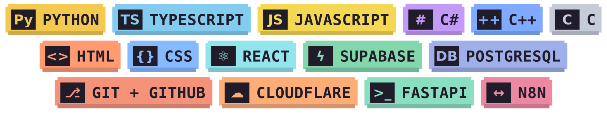

<p align="center">
  <a href="https://danielviana-portfolioweb.vercel.app/">
    
  </a>
</p>

# Daniel Viana Lima

**Dados, IA e desenvolvimento full stack**

Graduando em Ciência da Computação na Estácio, em Sergipe. Uso Python para trabalhar com dados e automação, e JavaScript para construir aplicações web e integrar APIs. Busco oportunidades de **estágio ou vaga júnior**.

[Projetos](#projetos-selecionados) · [Portfólio e currículo](https://danielviana-portfolioweb.vercel.app/) · [LinkedIn](https://www.linkedin.com/in/dev-danielvianalima/) · [E-mail](mailto:vianalimadaniel@gmail.com)

## 🎮 Sobre mim · `player_status.py`

```python
class Daniel:
    local = "Sergipe, Brasil"
    formacao = "Ciência da Computação · Estácio"
    buscando = ("Estágio", "Vaga júnior")
    foco = ("Dados", "IA", "LLMs", "Full stack", "Automação")

    def idiomas(self):
        return {
            "Português": "Nativo",
            "Inglês": "Intermediário",
            "Espanhol": "Básico",
            "Francês": "Básico",
        }

    def fora_do_terminal(self):
        return (
            "Física e ciências naturais 🔭",
            "Xadrez ♟️",
            "Bolar ideias de software que ainda não existem 💡",
        )

    def missao_atual(self):
        return "Aprender sempre. Nível não é teto, é checkpoint."
```

> Seja estudando física ou lendo código, gosto de seguir a lógica até conseguir explicar por que as coisas funcionam.

## 🧰 Hard skills · `skills.ini`

<p align="center">
  
</p>

<sub>Barras de XP · Minha autoavaliação de prática.</sub>

<table>
  <tr>
    <td width="50%" valign="top">
      <p><strong>Python</strong> <code>███████░░░</code> <strong>7/10</strong><br>Tratamento de dados, bots e APIs.</p>
      <p><strong>TypeScript</strong> <code>████░░░░░░</code> <strong>4/10</strong><br>Tipagem em projetos React.</p>
      <p><strong>JavaScript</strong> <code>█████░░░░░</code> <strong>5/10</strong><br>DOM, interfaces e APIs com Node.js.</p>
      <p><strong>React</strong> <code>████░░░░░░</code> <strong>4/10</strong><br>Componentes, hooks e interfaces.</p>
    </td>
    <td width="50%" valign="top">
      <p><strong>Supabase</strong> <code>███░░░░░░░</code> <strong>3/10</strong><br>Autenticação e dados em tempo real.</p>
      <p><strong>PostgreSQL</strong> <code>███░░░░░░░</code> <strong>3/10</strong><br>Modelagem relacional e consultas SQL.</p>
      <p><strong>C++</strong> <code>██░░░░░░░░</code> <strong>2/10</strong><br>Aplicações com Arduino.</p>
      <p><strong>C#</strong> <code>███░░░░░░░</code> <strong>3/10</strong><br>Programação orientada a objetos.</p>
    </td>
  </tr>
</table>

## Projetos selecionados

<sub>📂 <code>quest_log.md</code></sub>

| Projeto | O que entreguei |
| --- | --- |
| [**LaranBot**](https://github.com/laranjodupy/LaranBotDev_Telegram) | Criei um template para bots do Telegram com webhook, banco D1 e integração com Workers AI. Documentei a configuração local, as migrações e o deploy.<br><sub>Python · FastAPI · Cloudflare Workers</sub> |
| [**Simple Graphs**](https://github.com/laranjodupy/plotting-dataframes) | Publiquei no [PyPI](https://pypi.org/project/plotting-dataframes-laranjodupy/) um pacote para carregar arquivos em DataFrames e configurar gráficos com menos código repetido.<br><sub>Python · Pandas · Matplotlib</sub> |
| [**Loja Rápida**](https://github.com/laranjodupy/Projeto_LojaRapida_JovemTech) | Participei da modelagem e validação de um banco de dados para uma loja. A equipe entregou esquema, dados de exemplo, views, consultas e transações.<br><sub>PostgreSQL · PL/pgSQL</sub> |
| [**Gestão de Alunos**](https://github.com/laranjodupy/stalkerdeAluno_JovemTech) | Desenvolvi em equipe uma aplicação de cadastro com validação na API e um painel de estatísticas.<br><sub>React · Node.js · Express</sub> |

## 🏆 Formação e certificados · `achievements.log`

<details>
<summary><strong>Ver formação e cursos concluídos</strong></summary>

- **Estácio** · Ciência da Computação, em andamento.
- **Jovem Tech / Conecta-SE** · [Formação em Desenvolvimento Full Stack](./componentes/Certificado_Jovem_tech.jpeg).
- **SENAI/CETAF** · Técnico em Eletroeletrônica.
- **Cisco Networking Academy** · [Data Science Essentials with Python](./componentes/Certificado_DS_Essentials_Daniel.pdf) e [Introduction to Cybersecurity](./componentes/I2CS_Daniel.pdf).
- **DIO** · Introdução à Análise de Dados com SQL, Fundamentos Teóricos sobre ETL, Fundamentos de Business Intelligence e bootcamp AI Automation com N8N.
- **DIO / Santander** · Aceleração em RAG com ChromaDB, LlamaIndex e Python.

</details>

<details>
<summary><strong>Rodar o portfólio localmente</strong></summary>

O site usa HTML, CSS e JavaScript. Clone este repositório e abra `index.html` no navegador. Para servir a pasta pelo terminal no Windows, execute `py -m http.server 8000` na raiz e abra [localhost:8000](http://localhost:8000).

</details>

## 🐍 Atividade no GitHub · `git log`

<picture>
  <source media="(prefers-color-scheme: dark)" srcset="https://raw.githubusercontent.com/laranjodupy/laranjodupy/output/github-snake-dark.svg">
  <source media="(prefers-color-scheme: light)" srcset="https://raw.githubusercontent.com/laranjodupy/laranjodupy/output/github-snake.svg">
  
</picture>
