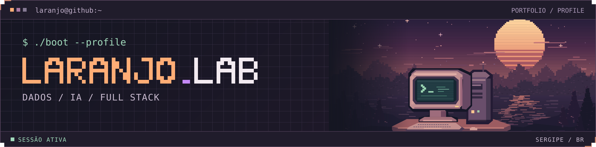

  

# Daniel Viana Lima

**Dados, IA e desenvolvimento full stack**

Graduando em Ciência da Computação na Estácio, em Sergipe. Uso Python para trabalhar com dados e automação, e JavaScript para construir aplicações web e integrar APIs. Busco oportunidades de **estágio ou vaga júnior**.

[Portfólio e currículo](https://danielviana-portfolioweb.vercel.app/) · [LinkedIn](https://www.linkedin.com/in/dev-danielvianalima/) · [E-mail](mailto:vianalimadaniel@gmail.com)

## `01` Projetos selecionados

| Projeto | O que entreguei |
| --- | --- |
| [**LaranBot**](https://github.com/laranjodupy/LaranBotDev_Telegram) | Criei um template para bots do Telegram com webhook, banco D1 e integração com Workers AI. Documentei a configuração local, as migrações e o deploy. Python · FastAPI · Cloudflare Workers |
| [**Simple Graphs**](https://github.com/laranjodupy/plotting-dataframes) | Publiquei no [PyPI](https://pypi.org/project/plotting-dataframes-laranjodupy/) um pacote para carregar arquivos em DataFrames e configurar gráficos com menos código repetido. Python · Pandas · Matplotlib |
| [**Loja Rápida**](https://github.com/laranjodupy/Projeto_LojaRapida_JovemTech) | Participei da modelagem e validação de um banco de dados para uma loja. A equipe entregou esquema, dados de exemplo, views, consultas e transações. PostgreSQL · PL/pgSQL |
| [**Gestão de Alunos**](https://github.com/laranjodupy/stalkerdeAluno_JovemTech) | Desenvolvi em equipe uma aplicação de cadastro com validação na API e um painel de estatísticas. React · Node.js · Express |

## `02` Stack em uso

- **Dados e IA** · `Python` `SQL` `Pandas` `Matplotlib`
- **Web e APIs** · `JavaScript` `React` `Node.js` `Express` `FastAPI`
- **Banco e infraestrutura** · `PostgreSQL` `Supabase` `Cloudflare Workers` `Git`

<strong>Formação e certificados</strong>

- **Estácio** · Ciência da Computação, em andamento.
- **Jovem Tech / Conecta-SE** · [Formação em Desenvolvimento Full Stack](./componentes/Certificado_Jovem_tech.jpeg).
- **SENAI/CETAF** · Técnico em Eletroeletrônica.
- **Cisco Networking Academy** · [Data Science Essentials with Python](./componentes/Certificado_DS_Essentials_Daniel.pdf) e [Introduction to Cybersecurity](./componentes/I2CS_Daniel.pdf).
- **DIO** · Introdução à Análise de Dados com SQL, Fundamentos Teóricos sobre ETL, Fundamentos de Business Intelligence e bootcamp AI Automation com N8N.
- **DIO / Santander** · Aceleração em RAG com ChromaDB, LlamaIndex e Python.

<strong>Rodar o portfólio localmente</strong>

O site usa HTML, CSS e JavaScript. Clone este repositório e abra `index.html` no navegador. Para servir a pasta pelo terminal no Windows, execute `py -m http.server 8000` na raiz e abra [localhost:8000](http://localhost:8000).

## `03` Atividade no GitHub

<picture>
  <source media="(prefers-color-scheme: dark)" srcset="https://raw.githubusercontent.com/laranjodupy/laranjodupy/output/github-snake-dark.svg">
  <source media="(prefers-color-scheme: light)" srcset="https://raw.githubusercontent.com/laranjodupy/laranjodupy/output/github-snake.svg">
  
</picture>

Fora do terminal, jogo xadrez e gosto de física.
